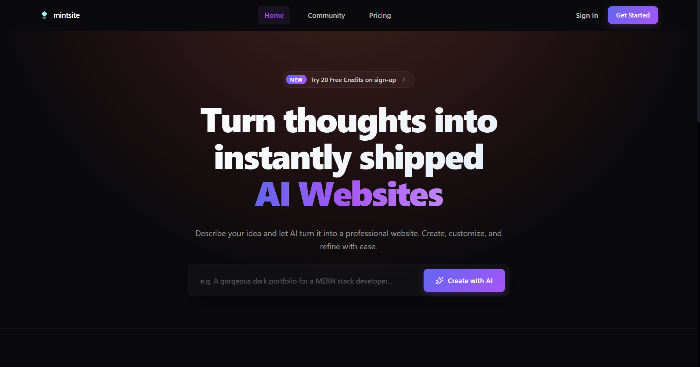
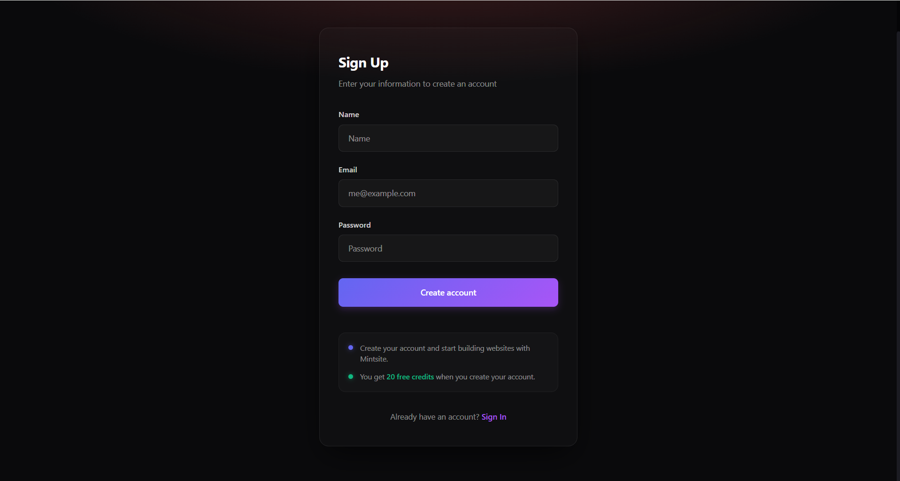
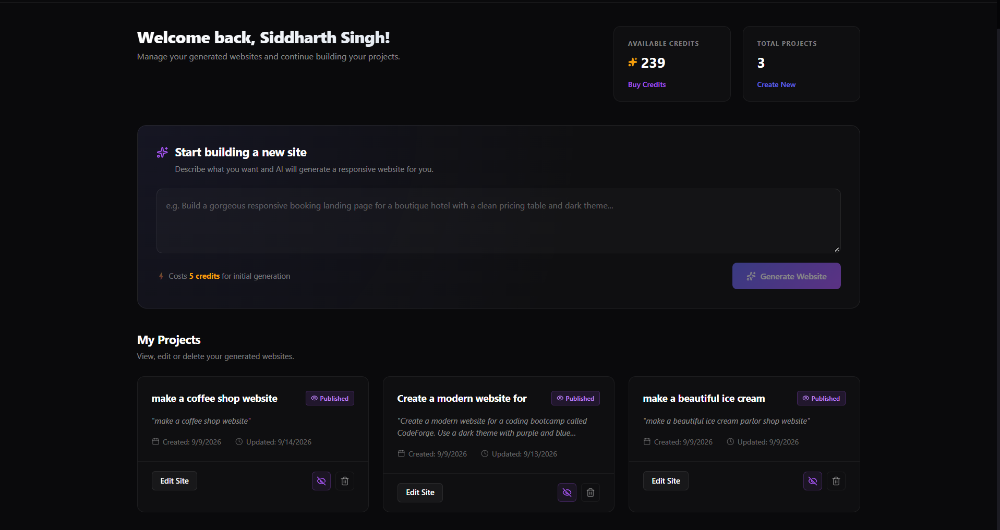
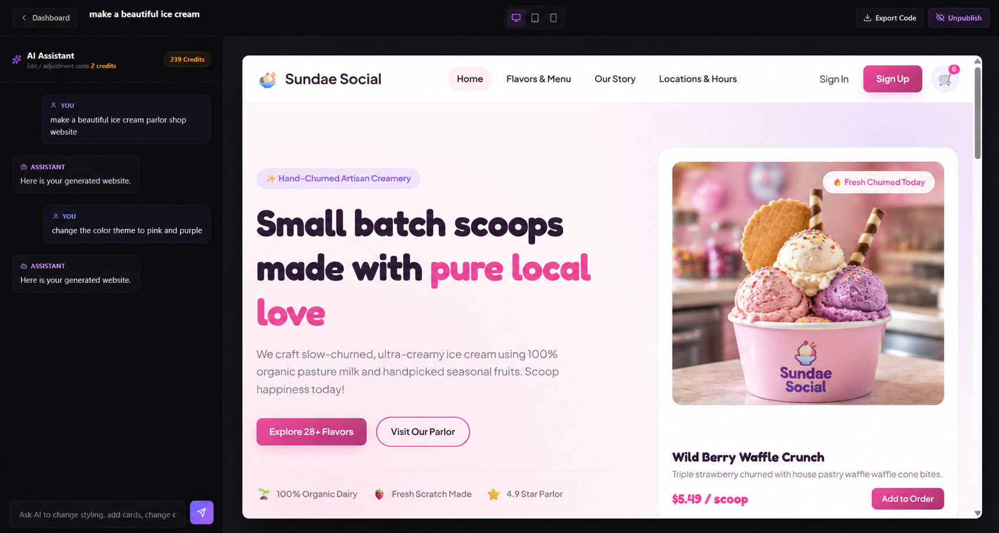
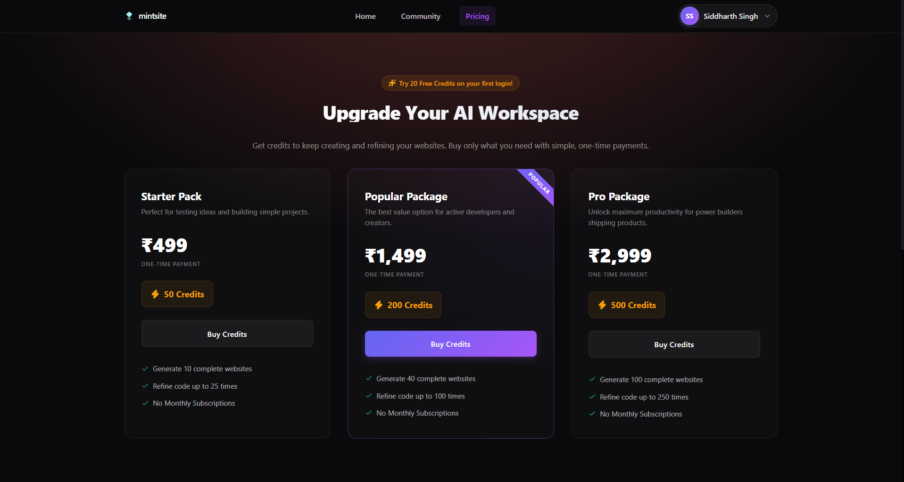
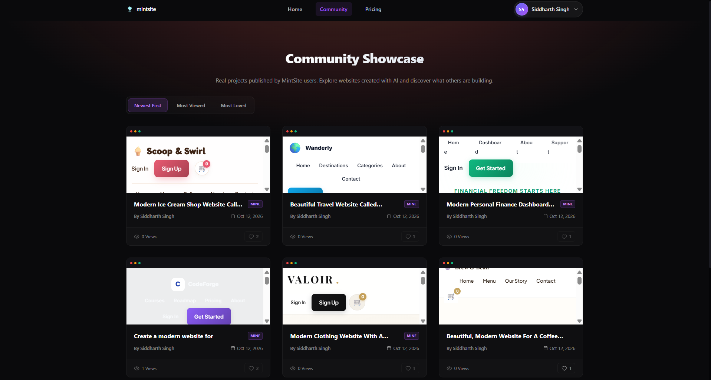

# 🌐 MintSite

> **An AI-powered website builder that turns a single natural-language prompt into a complete website — with a chat-based workspace for refinement, live responsive preview, a credit system, Razorpay payments, and a community showcase.**

<p align="center">
  
</p>

MintSite is a full-stack MERN application where users describe the website they want, and AI generates the complete **HTML, CSS and JavaScript** for it. Everything happens in a single workspace: generate the site, keep refining it through chat, and watch the live preview update instantly. Finished websites can be published to a community showcase, and credits can be purchased through Razorpay.

The project integrates multiple services — **Gemini API, Groq API, Razorpay, MongoDB, and React** — into a single full-stack application.


## 🚀 Features

### 🔐 Authentication & Account Management

* User registration and login/logout
* **20 free credits** on sign-up
* Email verification
* Password change
* Profile update
* Account deletion
* Protected backend APIs

<p align="center">
  
</p>

### 📊 Dashboard & Project Management

* Dashboard showing available credits and total projects
* Start a new website directly from a prompt box
* View all existing projects with created/updated dates
* Open, edit, and delete projects
* Publish / unpublish a project with one click

<p align="center">
  
</p>

### 🤖 AI Website Workspace (Generate → Refine → Preview)

Generation, refinement, and preview live together in one workspace, so every change is visible immediately.

* Describe a website in plain language
* The prompt is first **enhanced using AI** for better results
* AI generates the website's **HTML, CSS and JavaScript**
* **Chat-based refinement:** give follow-up instructions like "change the color theme to pink and purple"
* Existing HTML and conversation history are passed to the AI as context, so it modifies the current site instead of starting over
* Every change is saved to **MongoDB**, along with the prompt and AI response history
* **Live preview** rendered safely through an iframe, updating as the website changes
* Responsive preview switcher for **desktop, tablet, and mobile** views
* **Export Code** to download the generated website
* Publish / unpublish directly from the workspace

<p align="center">
  
</p>

### 💳 Credit System

* Website generation consumes credits
  * **Initial generation:** 5 credits
  * **Each edit / refinement:** 2 credits
* Available credits are visible in the dashboard and workspace
* Generation is blocked when credits are insufficient

### 💰 Razorpay Payments

* One-time credit packages, no monthly subscription
* Razorpay order creation
* Server-side payment verification
* Credits added automatically after successful payment

| Package | Price | Credits |
| ------- | ----- | ------- |
| Starter Pack | ₹499 | 50 |
| Popular Package | ₹1,499 | 200 |
| Pro Package | ₹2,999 | 500 |

<p align="center">
  
</p>

### 🌐 Community Showcase

* Publish your generated website to the community
* Browse websites published by other users
* Sort by **Newest First**, **Most Viewed**, or **Most Loved**
* Open a full preview of any published website
* Your own projects are marked with a **MINE** badge
* Like / unlike projects with a maintained like count (users cannot like their own projects)
* View tracking on published projects, with repeat views from the same user handled appropriately

<p align="center">
  
</p>

### 🛟 Fallback Website Generator

* If the AI service is unavailable, a fallback generator creates a website using predefined logic
* Keeps the core experience working even during AI downtime

---

## 🏗️ Architecture

```text
                    ┌─────────────────────┐
                    │  React + Vite App   │
                    │                     │
                    │  AI Workspace       │
                    │  Live Preview       │
                    │  (iframe)           │
                    └──────────┬──────────┘
                               │
                         REST API
                               │
                               ▼
                    ┌─────────────────────┐
                    │   Node.js + Express │
                    │      Backend        │
                    └──────────┬──────────┘
                               │
        ┌──────────────┬───────┴───────┬──────────────┐
        │              │               │              │
        ▼              ▼               ▼              ▼
  ┌──────────┐   ┌──────────┐    ┌──────────┐   ┌──────────┐
  │ MongoDB  │   │  Gemini  │    │   Groq   │   │ Razorpay │
  │ Database │   │   API    │    │   API    │   │ Payments │
  └──────────┘   └──────────┘    └──────────┘   └──────────┘

              ┌──────────────────────────────┐
              │  Fallback Website Generator  │
              │  (used if AI is unavailable) │
              └──────────────────────────────┘
```

---

## 🛠️ Tech Stack

| Category           | Technology                 |
| ------------------ | -------------------------- |
| Frontend           | React.js (Vite)            |
| Backend            | Node.js, Express.js        |
| Database           | MongoDB                    |
| AI Generation      | Gemini API, Groq API       |
| Payments           | Razorpay                   |
| Live Preview       | HTML rendered in iframe    |
| API                | REST                       |
| Deployment         | Vercel                     |
| Version Control    | Git & GitHub               |

---

## ⚙️ Getting Started

**1. Clone the repository**
```bash
git clone https://github.com/sidd-singh04/AI-Website-Builder-Mintsite.git
cd AI-Website-Builder-Mintsite
```

**2. Install dependencies**
```bash
cd frontend && npm install
cd ../backend && npm install
```

**3. Set up environment variables**

Copy `.env.example` to `.env` in both `frontend/` and `backend/`, and fill in your own credentials for MongoDB, Gemini, Groq, and Razorpay.

**4. Run the app**
```bash
# in backend/
npm run dev

# in frontend/ (separate terminal)
npm run dev
```

The app will be available at `http://localhost:5173` (or whichever port your frontend dev server prints).

---

## 🧠 Technical Highlights

* Built an end-to-end **AI website builder** that generates HTML, CSS and JavaScript from a single prompt.
* Combined generation, chat-based refinement, and live preview into a **single workspace** for instant feedback.
* Added an **AI prompt-enhancement step** before generation to improve output quality.
* Implemented **iterative refinement** by passing the existing website and conversation history back to the AI.
* Stored generated websites, versions and conversation history in **MongoDB**.
* Rendered generated websites safely using an **iframe** with desktop, tablet, and mobile preview modes.
* Designed a **credit-based usage system** (5 credits for generation, 2 per edit) with insufficient-credit checks and free sign-up credits.
* Integrated **Razorpay** for order creation, payment verification, automatic credit top-up and payment history.
* Built a **community showcase** with publish/unpublish, sorting, likes/unlikes, and view tracking.
* Added business rules such as blocking likes on a user's own project and handling repeat views.
* Built a **fallback generator** so website creation still works when the AI service is unavailable.
* Designed REST APIs using **Node.js and Express**.
* Kept service credentials and application configuration in environment variables.

---

## 🔐 Security & Configuration

Sensitive credentials are managed through environment variables rather than being hardcoded in the source code.

Configuration includes:

* MongoDB connection string
* Gemini API key
* Groq API key
* Razorpay key ID and secret
* Frontend/backend URLs

A `.env.example` file documents the required environment variables without exposing actual credentials.

---

## 🎯 Project Focus

MintSite was built to gain practical experience with the architecture of a modern full-stack application, including full-stack development, REST API design, authentication, database integration, AI API integration, prompt design, payment gateway integration, credit-based usage, community features, and production deployment.

---

## 👨‍💻 Author

**Siddharth Singh**
GitHub: [@sidd-singh04](https://github.com/sidd-singh04)
